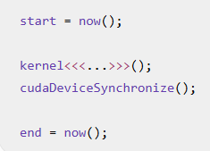
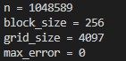
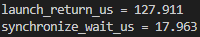
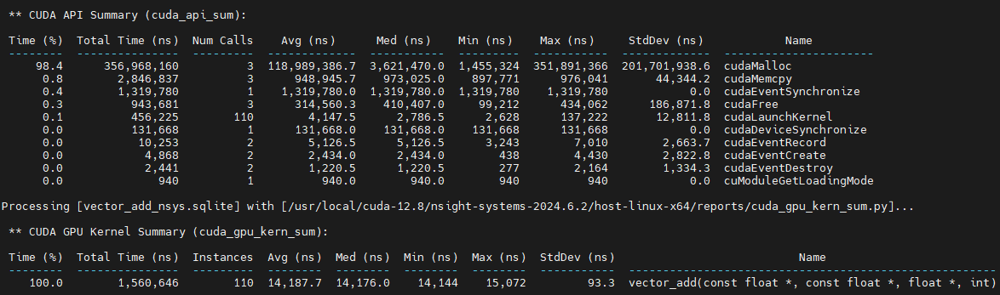

# 基础概念
1. 软件/编程模型：Kernel --> Grid --> Block --> Warp --> Thread.
2. 硬件模型：GPU -->SM --> CUDA Core / Tensor Core / Load-Store Unit --> Register / Shared Memory / Cache. CUDA主要负责将软件任务映射到硬件资源上执行。
3. SIMT：Single Instruction, Multiple Threads. 可以理解为，一组线程执行相同的指令，但是每个线程操作自己的数据。
4. Block / Warp / Thread: 一个block只能运行在一个SM上。一个Block分成多个warp，一个warp分成32个threads。在一个block中的thread有两个重要能力：共享shared memory 和 同步。
5. Grid 与 kernel：kernel表示在GPU上执行的函数；Grid 是所有block的组合。
6. SM：每个SM包含Warp Scheduler, CUDA Cores, Tensor Cores, Load / Store Units, SFU, Register File, Shared Memory / L1 Cache. 在一个SM上面通常可以驻留多个Block，每个Block又产生很多Warp。
7. CUDA Core: 执行MUL, ADD, FMA。相当于一个ALU。
8. Tensor Core: 是现代LLM GPU推理最重要的计算资源之一。执行 D = AB+C. 比如执行 16*16*16 这种MMA。
9. 重要的映射关系：Block被分配到SM，Warp被SM调度，Warp中的Thread指令最终由CUDA Core, Tensor Core, Load/Store Unit 等硬件执行。
10. GPU Memory Hierarchy: 分成四级：Registers --> L1/Shared Memory --> L2 --> HBM/Global Memory. 寄存器是每个线程使用的，L1 Cache是每个SM中的所有线程共享（位于SM内部的SRAM），L2 Cache是整个GPU的所有SM共享。

# Kernel Launch、异步执行和 `cudaDeviceSynchronize()`
1. Kernel launch: 比如有一个kernel函数，调度100个block，每个block有256个线程。那么vector_add<<<100, 256>>>(A, B, C) 就是启动：
100 blocks * 256 threads。 这个过程就叫做 kernel launch. 
2. cudaDeviceSynchronize()：CPU停下来，直到GPU前面提交的任务执行完成。一个典型的用途是：测量kernel时间：  


# CUDA语法
## __global__ 函数
一个global 函数的代码只写一份，但是一次kernel launch 会让很多线程同步执行这份代码。所以kernel函数通常会按照“单个线程应该做什么”来编写。

变量的作用范围：
1. 普通局部变量，例如i, value: 每个线程独立一份；
2. Register: 每个线程独立;
3. Shared Memory: 每个block的线程可以访问，但是不能跨block。
4. Global Memory: 整个grid中的线程都可以访问。

一个kernel可以同时包含：
1. 线程级操作：计算 tid，读取 x[i].
2. Warp 级操作：__shfl_down_sync.
3. Blcok 级操作：共享warp_sums, syncthreads().
4. Grid 级结果：多个Blcok用atomicAdd更新 out。

## CUDA的库
1. 数学与线性代数库
这类库是科学计算和深度学习的基石。
    1. cuBLAS：线性代数函数库。主要功能：做稠密的线性代数，比如GEMM, GEMV. 
    2. cuBLASLt：专注于GEMM的极致性能。
    3. cuSPARSE: 用于稀疏矩阵的线性代数库，处理稀疏数据时比CPU快30-150倍。
    4. cuSOLVER：提供稠密和稀疏矩阵的直接求解器，用于解决线性方程组等问题。
    5. cuTENSOR: 高性能张量线性代数库，支持张量收缩、归约等操作，常用于深度学习。
2. 并行算法与通信库
这类库帮助开发者构建高性能的并行程序。
    1. Thrust: 类似C++ STL的高层并行算法库，提供sort、scan、reduce等操作，提升开发效率。
    2. CUB：低层、CUDA专用的并行原语库，提供Warp/Block/Device级的集合操作，用于编写自定义高性能内核。
    3. NCCL：NVIDIA集合通信库，为多GPU和多节点提供高性能的通信原语（如AllReduce），是分布式训练和推理的关键
3. 深度学习与推理库
这些库为AI应用提供核心加速。
    1. cuDNN：深度神经网络原语库，提供卷积、池化、激活等操作的优化实现，是PyTorch、TensorFlow等框架的底层加速库。
    2. TensorRT / TensorRT-LLM：高性能深度学习推理SDK，专门用于优化和部署模型，尤其针对LLM推理进行了深度优化。
    3. CUTLASS: 用于实现高性能矩阵乘法（GEMM）的C++模板库，允许开发者自定义和优化内核。

# 实验1：Vector_add
## 基础实验
1. 编译（先进入week1/day1_kernel_launch）：nvcc -std=c++17 -O3 -arch=sm_80 vector_add.cu -o vector_add
2. 运行：./vector_add
运行结果如下：  


## 观察异步launch
实验结果如下：  


## 使用CUDA Event 测量 kernel时间
目标是得到kernel 的平均 GPU执行时间和有效内存带宽。
实验结果如下：  
total_kernel_ms = 1.03526
avg_kernel_ms = 0.0103526
bandwidth_gbs = 1215.45
而A100 PCIE 40GB 的理论显存带宽约为1555GB/s。我这里的有效带宽约为理论值的78%。

## 测试不同的block size
Block Size      Avg Kernel Time         Bandwidth   
128             0.0157                  800     
256             0.01057                 1189        
512             0.01013                 1241        
1024            0.01064                 1181        
结果分析：对于128，总block较多，可能block调度和管理开销相对更加明显。

## 两种计时方式之间的差距


## 基于Nsight Systems 的Profiling
先export某一张卡，然后在编译完check2.cu 文件之后，使用Nsight Systems 采集时间线：
```
 nvcc -std=c++17 -O3 -arch=sm_80 vector_add_check2.cu -o vector_add_check2
```

```
nsys profile \
    --trace=cuda,osrt \
    --stats=true \
    --force-overwrite=true \
    -o vector_add_nsys \
    ./vector_add_check2
```

然后检查：
```
 nsys stats     --force-export=true     --report cuda_api_sum,cuda_gpu_kern_sum,cuda_kern_exec_sum     vector_add_nsys.nsys-rep
```

输出结果如下：  


可以看到：
1. Kernel 实际执行时间：CUDA GPU Kernel Summary 中，可以看到平均 GPU Kernel 的访问时间为14.19 us。这说明 Nsight 确实捕获到了你的所有 vector_add Kernel。
2. CUDA API Summary 的含义
cudaLaunchKernel       110 次，平均约 4.15 μs  
cudaEventRecord          2 次  
cudaEventSynchronize     1 次  
cudaDeviceSynchronize    1 次  
cudaMemcpy               3 次  
cudaMalloc               3 次  
3. CUDAMalloc 占据的时间是真的多啊。

实验结论：  
Nsight Systems 显示，Vector Add 的 CPU Kernel Launch 平均约为 4.15 μs，GPU Kernel 实际执行平均约为 14.19 μs。连续提交 110 个 Kernel 后，Kernel 平均排队时间约为 599 μs，说明 CPU 提交速度快于 GPU 执行速度，异步 Launch 会导致 CUDA Stream 中形成排队。第一次 cudaMalloc 的初始化开销约为 352 ms，因此不能将程序初始化时间混入 Kernel Benchmark。


# 实验2：Reduction
目标是将一个数组：x[0], x[1], ..., x[n-1] 归约成一个数：
sum = x[0] + x[1] + ... + x[n-1]。

## Version 1: Global Atomic Reduction
这个版本中，每个线程读取一个元素，然后把结果累加到同一个GPU地址。
编译运行：
```
nvcc \
    -std=c++17 \
    -O3 \
    -arch=sm_80 \
    -lineinfo \
    reduction.cu \
    -o reduction
```

### Error 运行结果
运行结果如下：
cpu_sum = 1.05016e+06
gpu_sum = 1.05016e+06
error = 0.125

### 性能分析结果
备注：每种block size跑出来的结果都不稳定。
Block Size      Avg Kernel Time         Bandwidth     
128             2.90                  1.44  
256             2.78                  1.50  
512             2.99                  1.40  
1024            2.80                  1.50  

结论：可以看到，这个有效带宽特别低！Global Atomic Reduction 的瓶颈是所有线程对同一个全局地址的原子竞争，因此调整 Block Size 对性能帮助有限。

## Version 2: Shared Memory Reduction
这个版本的kernel执行结构为：    
每个线程从 Global Memory 读取一个元素   
        ↓   
写入当前 Block 的 Shared Memory   
        ↓   
Block 内进行树形归约    
        ↓   
线程 0 得到当前 Block 的局部和  
        ↓   
线程 0 使用 atomicAdd 更新全局结果  

### 运行结果
Block Size      Avg Kernel Time         Bandwidth     
128             0.0427                  98
256             0.0275                  152
512             0.0260                  160
1024            0.0300                  139

结论：相比于原子操作，速度大大加快，提升大约百倍。Block size 也存在平衡点，并不能单纯增大Block size来提升性能。

## Version3： Shared Memory Reduction + Warp Reduction
每个线程读取一个元素  
        ↓  
每个 Warp 内用 __shfl_down_sync() 求和  
        ↓  
每个 Warp 的 lane 0 写入 warp_sums[]  
        ↓  
第一个 Warp 再对 warp_sums[] 求和  
        ↓  
Block 内线程 0 执行一次 atomicAdd()  

### 运行结果
Block Size      Avg Kernel Time         Bandwidth     
128             0.0415                  101     
256             0.0258                  162     
512             0.0181                  231     
1024            0.0169                  248     

结论：进一步提速了。则是因为：（1）减少了原子操作。每个blcok只进行一次。当block size 增大，全局原子操作减少。（2）Warp shuffle 使用寄存器交换数据，warp 内的规约不需要经过shared Memory，更快了。


# 实验3：RMSNorm
## Version 1：让每个Block负责一行数据。
### 运行结果
Block Size      Avg Kernel Time         Bandwidth     
128             0.0121                  86
256             0.0096                  109
512             0.0090                  117
1024            0.0101                  101

结果分析：随着Block size 的增大，每个线程串行累加的元素减少，行内并行度高，耗时下降。但是如果继续增大，可能导致归约轮数、同步成本增加，从而抵消收益。

## Pytorch 调用 CUDA Kernel
调用链为：Python Tensor --> C++ 接口 --> 现有CUDA kernel --> 输出Tensor

运行命令为：
```
export CUDA_HOME=/usr/local/cuda
export PATH="$CUDA_HOME/bin:$PATH"
export TORCH_CUDA_ARCH_LIST="8.0"

CUDA_VISIBLE_DEVICES=0 python3 test_rmsnorm.py
```

实验结果：  
max_abs_error = 1.430511474609375e-06  
PyTorch 调用和正确性测试通过


# 总结
1. 重新学习了GPU的基础概念，包括软件模型、硬件模型、软硬映射。
2. 实现了vector_add 的 kernel，并使用Nsight Systems 进行了性能分析。
3. 进行了 Reduction 的实验，分为全局原子归约、Block 内树形归约和Warp 内部归约三种方式。
4. 实现了RMSNorm 的kernel，并使用Pytorch 调用C++接口进行测试。