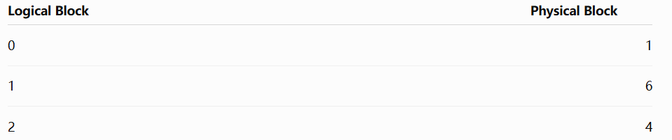
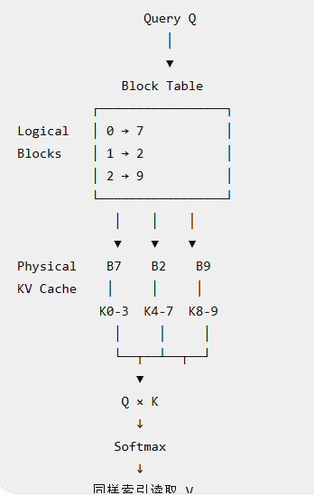
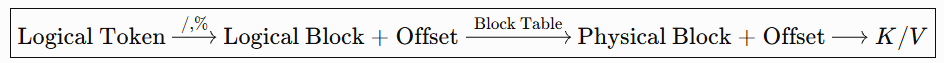
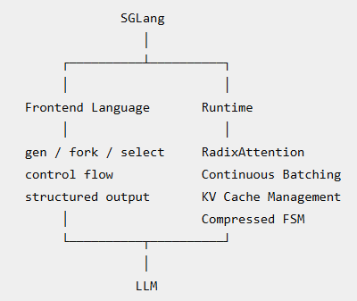
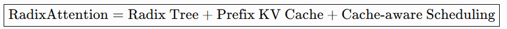
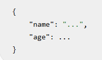

# vLLM
## 背景
有很多Request 时，如何调度，如何管理KV Cache。所以它属于非常典型的LLM Serving System.
它回答的问题是：大量普通LLM请求，怎样高效管理KV Cache，并进行高吞吐 Serving ？

## PagedAttention
### 传统做法的问题
传统做法往往给每个request预留一块连续的KV Cache，但不同请求长度不同，而且decode时 KV Cache 动态增长。
如果提前分配大块连续缓存，容易产生：内部碎片，外部碎片，显存预留过多。
最终导致，虽然GPU还有算力，但是因为KV Cache 放不下更多Request, Batch size 上不去。

### 虚拟内存分页
虚拟内存分页：KV Cache 不再要求物理连续，只需要逻辑连读。
比如，每个Block 存4个tokens，然后假设A有10个token，分成3个block。于是vLLM维护一个Block Table，类似：

Attention kernel 根据 Block Table 找到真正的KV.

总而言之：传统 KV Cache 把一个 sequence 当成一块连续数组；PagedAttention 则把 sequence 切成固定大小的 KV Block，通过 Block Table 把逻辑连续的 KV Cache 映射到不连续的 GPU 物理显存。

### 如何访问不连续的 K/V Block（利用Block Table）
PagedAttention 并不是先把离散 KV Block 拷贝成连续空间再做 Attention，而是 Attention Kernel 直接拿着 Block Table 去访问离散的物理 Block。

### 新token 的KV写到哪里
vLLM 不是在生成新 token 时临时 cudaMalloc 一块显存，而是启动时就建立一个大的 KV Cache Block Pool，运行时只是在这些 Physical Blocks 之间做分配和回收。

### 整体流程
   
所以可以把PagedAttention 的本质记成：

## Continuous Batching
### 传统做法的问题
传统Static Batching: 必须等整个batch 结束才能换下一批。这导致GPU利用率很低。
Continuous Batching: 每次decode iteration 都可以：移除已经结束的请求，插入新的请求，重新组成batch——这就是一个iteration-level scheduling。

### Scheduler 每轮在做什么
1. 检查GPU / KV Cache 资源；
2. 本轮运行哪些请求。
3. 这一轮GPU Forward;
4. 谁结束了？谁还要继续？
5. 下一轮重新调度。

### Prefill怎么办
比如A, B, C 正在Decode，这时候D刚刚到达，有一个1000 token prompt，运行D可能导致A B C 等很久。
所以，vLLM支持Chunked Prefill。

### 和 PagedAttention 高度配合
Continuous Batching --> 提高计算资源利用率。
PagedAttention --> 提高显存利用率。

# SGLang
## 背景
它关注的场景是：不同generation之间存在大量重复的prefix，多轮LLM调用，需要结构化的输出，Agent的多分枝推理。
例如：
Request A:
System Prompt + Few-shot Examples + Question A

Request B:
System Prompt + Few-shot Examples + Question B

前面可能几千个 token 完全一样。

所以，SGLang的核心思想就是：把KV Cache 从“某一个 request 的临时状态”，升级成整个 serving system 可以复用的缓存——KV Cache 怎么跨请求复用。

## 整体架构

## 最重要的贡献：RadixAttention
不同请求（假设他们有部分相同的前缀），它们的KV Cache不再分别存，而是组成一棵Radix Tree. 
所以，
1. request 完成之后KV Cache 不会立即删除；
2. 新请求来了之后先找longest prefix match；
3. 显存不足时用类似LRU的策略淘汰 cache；
4. cache-aware scheduling: 优先运行能够复用更多prefix KV Cache的请求，从而提高cache命中率。

整体可以记成：

Radix tree 的特点：连续的单分支节点可以压缩成一个节点。

### KV Cache eviction
决定显存满了删谁。策略是：LRU (Least Recently Used) + leaf-first eviction. 也就是优先在叶子节点中，删除 Least Recently Used 的节点。这样可以尽可能保留共享祖先。

### Cache-Aware Scheduling
根据prefix reuse来调整请求顺序。比如有3个请求：R1， R2, R3。其中R1和R3共享很长的prefix。那么：先执行R1，再执行R3，最后执行R2. 

## 第二个贡献：Structured Output 加速
如果要求模型必须输出一段结构性的语言：  
  
那么，会把一串已经确定的token，当成一个小的prefill chunk，一次forward送进模型，而不是一个token 一个 token 地做自回归解码。这一个过程应该主要是为了更新kv cache。